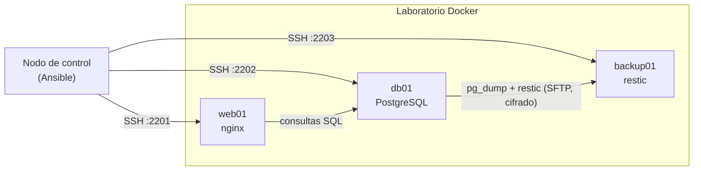

# Arquitectura

Tres máquinas simuladas con contenedores Docker (Ubuntu 22.04, systemd y SSH), gestionadas
desde un nodo de control con Ansible.

| Máquina | Grupo | Rol | Datos persistentes |
|---------|-------|-----|--------------------|
| web01 | webservers | webserver | — |
| db01 | databases | database, backup | volumen `db_data` |
| backup01 | backup_servers | (lo prepara el rol backup) | volumen `restic_repo` |

## Roles

- **common**: paquetes, zona horaria, hora y locale. Se aplica a todas.
- **webserver**: nginx y página generada con plantillas Jinja2.
- **database**: PostgreSQL, usuario, base de datos y datos de ejemplo.
- **backup**: `pg_dump` en db01, cifrado con restic y envío por SFTP a backup01.
  Retención de 7 diarias, 4 semanales y 6 mensuales; diaria a las 03:00 (hora española).

## Secretos

Ansible Vault (`inventory/group_vars/all/vault.yml`): contraseña del repositorio restic
y contraseña de la base de datos.

## Persistencia

Los datos de la BD y el repositorio de copias están en volúmenes con nombre. Destruir
db01 no borra las copias de backup01, y de ahí sale la demo de recuperación.
